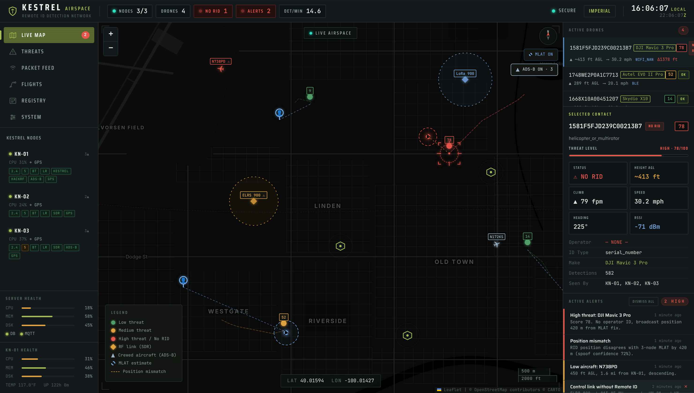

# KESTREL AIRSPACE

> Open-source airspace awareness platform. Distributed KESTREL nodes (KN-xx) passively detect FAA Remote ID broadcasts over Wi-Fi NAN and Bluetooth 5 LR, spot drone control links with an SDR, and hear crewed aircraft over ADS-B, feeding a central server that correlates detections across nodes, identifies drone make and model from FAA Declaration of Compliance records, scores threats, and verifies positions via MLAT trilateration.
>
> _Formerly AEGIS (platform) and ARGUS (nodes). The full rename to KESTREL — directories, services, MQTT topics, env vars, and node callsigns (KN-xx) — is complete; see `docs/kestrel-migration.md` for the fleet cutover steps._

```
                    ┌──────────────────────────────────────────┐
                    │          KESTREL (UI)               │
                    │  Live map · Threat scores · MLAT circles │
                    │  Packet feed · Node health · Alert feed  │
                    └──────────────────┬───────────────────────┘
                                       │ WebSocket /ws
                    ┌──────────────────▼───────────────────────┐
                    │            KESTREL SERVER                  │
                    │  FastAPI · TimescaleDB · MQTT broker     │
                    │  Alert engine · Trilateration · Threat AI│
                    └──────┬───────────────┬───────────────┬───┘
                           │ MQTT          │ MQTT          │ MQTT
                    ┌──────▼─────┐  ┌──────▼─────┐  ┌──────▼─────┐
                    │  KN-01  │  │  KN-02  │  │  KN-03  │
                    │  Wi-Fi NAN │  │  Wi-Fi NAN │  │  Wi-Fi NAN │
                    │  BT5 LR    │  │  BT5 LR    │  │  BT5 LR    │
                    │  RTL-SDR   │  │  GPS       │  │  RTL-SDR   │
                    │  GPS       │  │            │  │  GPS       │
                    └────────────┘  └────────────┘  └────────────┘
```

KESTREL detects FAA-mandated Remote ID broadcasts from drones across all three radio technologies (Wi-Fi NAN, Bluetooth 4 legacy, Bluetooth 5 Long Range), correlates detections from multiple sensor nodes, estimates true drone position via RSSI trilateration (MLAT), and scores each drone with an 8-factor threat model. Everything streams live to KESTREL — a tactical operations dashboard with a real Leaflet map, animated threat gauges, and a live packet feed.



---

## Table of Contents

- [Quick Start](#quick-start)
- [Architecture](#architecture)
- [Hardware](#hardware)
- [Deployment](#deployment)
  - [KESTREL Server](#kestrel-server-deployment)
  - [Managing the server](#managing-the-server)
  - [KESTREL nodes](#kestrel-node-deployment)
  - [Remote access — Tailscale](#remote-access--tailscale-recommended)
  - [WireGuard VPN](#wireguard-vpn-alternative)
  - [Drone make/model reference](#drone-makemodel-reference)
  - [Drone registry](#drone-registry)
- [Calibration](#calibration)
- [KESTREL](#kestrel)
- [API Reference](#api-reference)
- [Threat Scoring](#threat-scoring)
- [MLAT / Trilateration](#mlat--trilateration)
- [Troubleshooting](#troubleshooting)
- [Development](#development)
- [Test Suite](#test-suite)

---

## Quick Start

```bash
# 1. Clone
git clone https://github.com/RED-RED-RED/project-kestrel
cd project-kestrel

# 2. Deploy KESTREL Server (Docker installed automatically; Ubuntu 24.04/26.04 LTS,
#    Debian 12+, or Pi OS 64-bit — a VM or bare metal both work)
sudo bash scripts/deploy-kestrel-server.sh

# 3. Deploy each KESTREL-NODE (on each Pi; it clones the repo itself)
wget https://raw.githubusercontent.com/RED-RED-RED/project-kestrel/main/scripts/deploy-kestrel-node.sh
sudo bash deploy-kestrel-node.sh

# 4. Verify
python3 scripts/healthcheck.py --server <SERVER_IP>
```

Open `http://<server-ip>` — KESTREL will appear.

---

## Architecture

### Components

| Component | Description | Runs on |
|---|---|---|
| **KESTREL-NODE** | Sensor node — scans Wi-Fi NAN, BT4/5, SDR; publishes to MQTT | Raspberry Pi 5 (8 GB) |
| **KESTREL Server** | Central platform — ingests MQTT, stores detections, runs analysis | Pi 5 / x86 mini PC / any 64-bit Linux + Docker |
| **KESTREL** | Tactical dashboard — live map, threats, packet feed, flight history, system health | Browser (Nginx) |
| **Calibration** | RSSI path-loss model fitting for MLAT accuracy | Runs anywhere |

### Data flow

```
KESTREL-NODE                    KESTREL Server                  KESTREL
──────────                    ────────────                  ────────────
WiFi NAN scan  ─── MQTT ───►  subscriber.py                useStore.js
BT5 LR scan    ─── MQTT ───►    │── INSERT detections       │── /ws WebSocket
SDR band scan  ─── MQTT ───►    │── UPSERT drone_tracks     │── /api/analysis
ADS-B          ─── MQTT ───►    │── aircraft_store          │
heartbeat      ─── MQTT ───►    │── alert_engine.evaluate   │
 (+ radio status)               │── pipeline.process        MapView.jsx
                                │     ├── trilateration     ThreatPanel.jsx
                                │     └── threat_scoring    RightPanel.jsx
                                └── ws_broadcaster.broadcast
```

### MQTT topic schema

| Topic | Direction | Content |
|---|---|---|
| `kestrel/<id>/detection` | node → server | Full RID frame, RSSI, node GPS |
| `kestrel/<id>/heartbeat` | node → server | CPU, memory, temperature, GPS fix (every 10 s), plus `radio_status` once a minute or on any change |
| `kestrel/<id>/status` | node → server | `online`/`offline` (LWT, retained) |
| `kestrel/<id>/rf_detection` | node → server | SDR-classified RF control/video link — OcuSync, ELRS, FPV video, etc. (optional) |
| `kestrel/<id>/aircraft` | node → server | ADS-B aircraft heard this interval (optional, [docs/adsb.md](docs/adsb.md)) |

Leave the node's `mqtt.topic_prefix` at `kestrel`: the server subscribes to `kestrel/#`.

**Per-radio status (`radio_status`).** One entry per radio (GPS, Wi-Fi 2.4 / 5 GHz, Bluetooth, each SDR, ADS-B), each with a state of `running`, `degraded` (working but missing something, e.g. no GPS fix or Bluetooth Long Range off), `down` (with the reason) or `off` (disabled in config), plus a few live rates such as frames, adverts or messages per minute. The GPS entry carries the u-blox's jamming and spoofing state and whether the survey-in is done. The dashboard shows it per band; a radio that stays down raises a `radio_down` alert.

---

## Hardware

### Per KESTREL-NODE (~$550–650 as configured)

Reference build for the current field node. Prices are rough street figures and will drift — treat them as ballpark, not a quote.

| Part | Example | Role | ~Cost |
|---|---|---|---|
| Single-board computer | Raspberry Pi 5 Model B (8 GB) | Host | $80 |
| Active cooler | GeeekPi Armor Lite V5 | Thermal | $12 |
| Boot storage | microSD (A2) or NVMe + HAT | OS + local cache | $15–40 |
| UPS | Geekworm X1202 (5 V out, 6–18 V in) | Ride-through power + clean shutdown | $55 |
| Wi-Fi adapters ×2 | Alfa AWUS036ACM | Wi-Fi NAN monitor mode (mt76x2u), one each for 2.4 and 5 GHz | $60 each |
| Bluetooth dongle | Nordic nRF52840 Dongle (PCA10059) | BT4 + BT5 Long Range (Coded PHY) | $11 |
| GPS module | u-blox NEO-M9N (USB) | Geolocation + jamming/spoofing detection | $77 |
| Active GPS antenna | SMA active patch/puck (external) | GPS reception — quality matters a lot (see note) | ~$30 |
| SDR | RTL-SDR Blog V4 (HackRF for 2.4/5.8 GHz) | RF link detection, 433 / 915 MHz / 1.2 GHz | $40 (HackRF $300+) |
| ADS-B receiver (optional) | Second RTL-SDR, e.g. Nooelec NESDR SMArt v5, + 1090 MHz antenna | Crewed-aircraft awareness ([docs/adsb.md](docs/adsb.md)) | ~$50 |
| Wi-Fi antennas | Dual-band 6 dBi N-male omni ×2 (e.g. MikroTik Groove spares) | External Wi-Fi | $0 on hand (~$26 new) |
| Enclosure | Weatherproof outdoor hotspot kit (RAK/MNTD style) | IP-rated housing | $60 |
| RF cabling & adapters | RG316 SMA/N pigtails, bulkhead panel mounts, SMA/RP-SMA adapter kit | Panel-mount RF interconnect | ~$42 |
| USB cabling | USB-A 3.0, USB-C 3.1 Gen2, USB-A extension (1 ft) | Peripheral interconnect | ~$24 |
| Panel hardware | Waterproof momentary power button, IP68 breather vent, status LED | Enclosure I/O | ~$25 |

Roughly **$550–600** per node with one Wi-Fi adapter and the RTL-SDR; the second adapter and ADS-B receiver add about $110. A HackRF (for 2.4/5.8 GHz coverage) adds ~$300+. Several items (GPS module, Wi-Fi antennas, storage) you may already have on hand.

**OS:** Raspberry Pi OS Lite 64-bit, **Trixie** recommended. The RTL-SDR Blog V4 needs Trixie's rtl-sdr 2.0.2; Bookworm's 0.6.0 can't drive its tuner.

**Enclosure fit and power** — space is tight. Two Alfas, two RTL-SDRs (or an RTL-SDR and a HackRF), the GPS and the nRF52840 can draw more than the Pi's USB ports supply, so plan on a compact **powered USB hub** (~$15–25) and shorter cables. A radio that randomly drops off USB is usually a power problem.

**Test equipment (not part of a node)** — a cooperative Remote ID broadcaster such as the **Ruko R111S** (~$40) is useful for validating detection end-to-end: fly or bench it and confirm the node picks it up on the map.

### KESTREL Server (~$150–250)

Any 64-bit Linux machine with Docker. The stack (TimescaleDB + Mosquitto + FastAPI + Nginx) is light on CPU but benefits from an **NVMe SSD** — TimescaleDB is write-heavy, so don't run the database on an SD card — and **16 GB RAM** for the history views. A fanless Intel N100/N305 mini PC (16 GB / NVMe, ~$150–250, 12–19 V input for vehicle/field use) is the sweet spot; a Raspberry Pi 5 (8 GB) with an NVMe HAT also works for small deployments. An old NUC or a cloud VPS works equally well.

### Critical hardware notes

**Alfa AWUS036ACM** — the `mt76x2u` driver is the only reliable option for capturing Wi-Fi NAN action frames in monitor mode. Most other adapters filter them out at the driver level.

**nRF52840 USB dongle** — must be flashed with [Zephyr `hci_usb` firmware](https://docs.zephyrproject.org/latest/samples/bluetooth/hci_usb/README.html) to appear as a standard HCI USB device. Most cheap "BT5" dongles advertise Coded PHY support but do not implement it in firmware — the nRF52840 is the reliable exception.

**u-blox NEO-M9N (USB, recommended)** — plug into any Pi USB port. The driver creates `/dev/ttyACM0`; the deploy script adds a udev rule so it also appears at the stable symlink `/dev/ttyGPS`. No UART configuration or serial console changes are needed. The GPS daemon auto-detects the port at startup, initialises the receiver via UBX binary protocol, and runs a **survey-in** (10 min minimum / 3 m accuracy target) to pin the node's precise position. Once the survey completes, `survey_complete` is set in the nodes table and that node receives a **3× weight multiplier** in the WLS trilateration solver. The NEO-M9N also reports hardware **jamming** and **spoofing** state via `UBX-NAV-STATUS`; critical/warning states trigger a `gps_jamming` alert on the server.

**u-blox NEO-M8N (UART, legacy)** — connect to Pi UART (`/dev/ttyAMA0`). Pass `--gps-mode uart` to the deploy script; it enables the UART in `/boot/firmware/config.txt` and disables the serial console. **A reboot is required** after this setup. The NEO-M8N does not support UBX survey-in or hardware jamming/spoofing detection.

**SDR frequency coverage** — the RTL-SDR Blog V4 reaches ~1.766 GHz, so on an RTL-SDR the scanner covers **433 / 900 MHz and 1.2 GHz** only; 2.4 and 5.8 GHz are above the tuner and are skipped automatically. A **HackRF** (1 MHz – 6 GHz) is supported for full coverage, including 2.4 GHz OcuSync/ELRS and 5.8 GHz FPV video — deploy the node with `--enable-hackrf` (installs libhackrf and SoapySDR and enables its `sdrs:` entry). The RTL-SDR and HackRF run side by side, each sweeping its own bands. The classifier is **receive-only**; the HackRF's transmit path is never used (jamming is illegal for non-federal operators). Classifier thresholds are first-order and meant to be field-calibrated against a known transmitter (e.g. a RadioMaster ELRS radio).

---

## Deployment

### KESTREL Server deployment

```bash
# Interactive
sudo bash scripts/deploy-kestrel-server.sh

# Non-interactive (Ansible, cloud-init, CI)
sudo bash scripts/deploy-kestrel-server.sh --unattended \
  --db-password yourdbpass --mqtt-password yourmqttpass --carto-key yourkey
```

The script installs Docker, generates credentials, configures Mosquitto auth, builds the dashboard and starts all containers via Docker Compose (`restart: unless-stopped`, so they come back after a reboot). Passwords are written to `kestrel-server/docker/.env` and to `DEPLOYMENT.md` in the repo root (both gitignored).

**Re-running is safe.** On an existing server it keeps `.env` as it is (database and MQTT passwords, API key, notification settings) and saves a timestamped backup beside it. The database password can't change after the first deploy (Postgres only takes it when the data volume is created); `--mqtt-password` changes the MQTT password, after which every node's config needs the new one.

> **OS support.** Tested on Ubuntu 24.04 and 26.04 LTS, Debian 12+, and Raspberry Pi OS (64-bit). Docker is installed via the official `get.docker.com` convenience script, which tracks new releases — including fresh LTS codenames. On a brand-new release the Docker apt repo can lag by a few days; if the script reports no candidate for your codename, either retry after a day or install the engine against the previous LTS codename:
> ```bash
> # Fallback only if get.docker.com has no package for a brand-new codename.
> # Point Docker's apt repo at the previous Ubuntu LTS (e.g. use "noble" on 26.04 "resolute"):
> echo "deb [arch=$(dpkg --print-architecture) signed-by=/etc/apt/keyrings/docker.asc] \
>   https://download.docker.com/linux/ubuntu noble stable" | sudo tee /etc/apt/sources.list.d/docker.list
> sudo apt-get update && sudo apt-get install -y docker-ce docker-ce-cli containerd.io docker-compose-plugin
> ```

**Running services after deployment:**

| Service | Port | Description |
|---|---|---|
| Nginx | 80 | KESTREL UI + API reverse proxy |
| KESTREL Server (FastAPI) | 8000 | Proxied by Nginx; also reachable directly (calibration tool, health check) |
| Mosquitto | 1883 | MQTT broker (authenticated) |
| TimescaleDB | 5432 | Server's localhost only |

Credentials are written to `kestrel-server/docker/.env` — back this file up.

### Managing the server

```bash
make server-up       # Start all containers
make server-down     # Stop all containers (data volumes are preserved)
make server-rebuild  # Rebuild and restart the kestrel-server container (use after code changes)
make server-logs     # Follow live logs from the FastAPI container
make server-status   # Show container status
```

The four containers that start together:

| Container | Port | Description |
|---|---|---|
| `nginx` | 80 | Serves KESTREL UI and proxies `/api` and `/ws` |
| `kestrel-server` | 8000 | FastAPI — starts after timescaledb and mosquitto are healthy |
| `mosquitto` | 1883 | MQTT broker (authenticated) |
| `timescaledb` | 5432 (localhost) | Time-series database |

### API authentication

All `/api/*` endpoints and the WebSocket are protected by an optional API key. Authentication is **disabled by default** (safe for trusted LAN deployments). To enable it, set `KESTREL_API_KEY` in `kestrel-server/docker/.env`:

```env
KESTREL_API_KEY=your-secret-key-here
```

Once set, every request must include the key as a header:

```
X-Api-Key: your-secret-key-here
```

The `/health` endpoint is always unauthenticated. It returns server CPU/memory/disk usage, database connectivity status, MQTT reachability (based on last node heartbeat), and online/total node counts — used by the KESTREL Server Health panel.

If you are running KESTREL from the same origin (via Nginx reverse proxy), add the key to the dashboard's build environment so it is included in API calls:

```env
# kestrel-dashboard/.env.production
VITE_API_KEY=your-secret-key-here
```

> **Recommendation:** Enable API key auth whenever KESTREL Server is reachable from outside your local network, such as over Tailscale, WireGuard VPN, or a public interface.

### KESTREL-NODE deployment

Flash Raspberry Pi OS Lite 64-bit (Trixie) to the SD card or NVMe, enable SSH, then on the Pi:

```bash
wget https://raw.githubusercontent.com/RED-RED-RED/project-kestrel/main/scripts/deploy-kestrel-node.sh
sudo bash deploy-kestrel-node.sh            # interactive: prompts for everything
```

Download it and run it as above; piping it into `bash` breaks the prompts. The script clones the repo to `/opt/kestrel-node`, writes `/etc/kestrel-node/config.yaml`, installs the `kestrel-node` service and offers to reboot.

Unattended, with both Wi-Fi bands, the RTL-SDR band scan and ADS-B:

```bash
sudo bash deploy-kestrel-node.sh --unattended \
  --node-id KN-01 --server-ip 192.168.1.100 --mqtt-password yourmqttpass \
  --mqtt-fallback kestrel-server \
  --wifi-iface-5g wlan2 \
  --enable-sdr --sdr-serial KESTREL \
  --enable-adsb --adsb-serial ADSB1090
```

All flags are in [kestrel-node/README.md](kestrel-node/README.md#install). A few things to know:

- **Two RTL-SDRs** (band scan + ADS-B) need their own serial numbers, set once per dongle with `rtl_eeprom`. See [docs/adsb.md](docs/adsb.md#multiple-rtl-sdrs-pin-them-by-serial); the deploy warns if they still share one.
- **Re-running** backs up the existing config and regenerates it from the flags, so pass the same flags again.
- **Legacy UART GPS** (NEO-M8N): add `--gps-mode uart` and reboot afterwards.

Then check it:

```bash
sudo systemctl status kestrel-node
sudo journalctl -fu kestrel-node
```

and the dashboard's **System** view, which shows every radio's live state. The node's scanners start up to 60 s after boot, once the GPS has a fix (or the wait times out).

### Remote access — Tailscale (recommended)

Nodes reach the server over the LAN when on-site and over [Tailscale](https://tailscale.com) when remote, automatically. The node tries its primary host (`mqtt.host`, the LAN IP) first; if that's unreachable within `mqtt.connect_timeout_s`, it flips to `mqtt.host_fallback` (the server's Tailscale name) and keeps alternating as conditions change — so a node works at home even if Tailscale is down, and from anywhere once it's up.

**1. Install Tailscale on the server and each node** (one tailnet for the whole fleet):

```bash
curl -fsSL https://tailscale.com/install.sh | sh
sudo tailscale up            # authenticate once in the browser link it prints
```

**2. Name the server and enable MagicDNS.** In the Tailscale admin console, rename the server machine to something stable (e.g. `kestrel-server`) and turn on **MagicDNS** (DNS tab) so that name resolves across the tailnet.

**3. Point nodes at both addresses.** Set the LAN IP as `host` and the server's Tailscale name as `host_fallback` — either at install time (`--mqtt-fallback kestrel-server`) or in `/etc/kestrel-node/config.yaml`:

```yaml
mqtt:
  host: "192.168.1.100"     # LAN IP — primary, used on-site
  host_fallback: "kestrel-server"   # Tailscale MagicDNS name — used when remote
  connect_timeout_s: 10
```

The Mosquitto container binds `0.0.0.0:1883`, so it's already reachable over the `tailscale0` interface — just allow 1883 from the tailnet in the server's firewall if you run one. The tailnet is the trusted network that the platform's LAN-only security model assumes; for tighter control, tag nodes (`tag:kestrel-node`) and restrict them to the server with a Tailscale ACL.

> **Enable API key auth** (see above) whenever the server is reachable beyond your LAN, Tailscale included.

### WireGuard VPN (alternative)

If you prefer a self-hosted VPN over Tailscale:

```bash
# On KESTREL server first
sudo bash scripts/setup-wireguard.sh server

# On each KESTREL node (prompts for server public key)
sudo bash scripts/setup-wireguard.sh node <SERVER_PUBLIC_IP> <NODE_INDEX>
```

VPN addressing: KESTREL server = `10.100.0.1`, nodes = `10.100.0.2`, `.3`, `.4`… With WireGuard, set `host_fallback` to the server's VPN address (`10.100.0.1`) for the same LAN-first / VPN-fallback behaviour.

### Health check

```bash
python3 scripts/healthcheck.py --server 192.168.1.100
python3 scripts/healthcheck.py --server 192.168.1.100 --api-key yourkey   # if KESTREL_API_KEY is set
```

Checks MQTT, the API, the dashboard and the database (directly when run on the server, through `/health` from anywhere else), lists each node's status with any radio that's down or degraded, and flags open HIGH alerts. Exits non-zero if a core service is unreachable.

### Updating

After pushing new code, update each machine from its own checkout.

**Server** (run from the repo root on the server host):

```bash
sudo bash scripts/update.sh server   # Pull latest, rebuild UI, rebuild + restart the API container
# or: make update
```

This runs a fast-forward `git pull`, rebuilds the dashboard (`kestrel-dashboard/dist`, which nginx serves live from a read-only volume, so no nginx restart is needed), then rebuilds and restarts the `kestrel-server` container. New database tables are created automatically on startup (`CREATE TABLE IF NOT EXISTS`), so there is no separate migration step. Add `--skip-ui` to leave the dashboard untouched, or `--no-pull` to rebuild the current checkout without fetching.

**Node** (run on each Raspberry Pi, repo at `/opt/kestrel-node`):

```bash
sudo bash scripts/update.sh node     # Pull latest, update venv deps, re-patch pyrtlsdr, restart the service
# or: make update-node
```

This does `git fetch` + `git reset --hard origin/main`, refreshes the systemd unit if it changed, reinstalls `kestrel-node/requirements.txt` into the venv, re-applies the Python 3.13 pyrtlsdr patch, and restarts `kestrel-node.service`. `/etc/kestrel-node/config.yaml` isn't touched, and system packages (dump1090-fa, HackRF) aren't installed: run the deploy script with the matching flag for those.

**Version check** (any host):

```bash
bash scripts/update.sh version       # Show current commit, branch, date, and API version
# or: make version
```

### Drone make/model reference

KESTREL decodes a broadcast Remote ID serial into a drone make and model. It matches the serial by **longest prefix** against serial prefixes taken from the FAA Declaration of Compliance (DoC) serial lists: within a filing every serial shares a model-specific prefix (e.g. a Skydio X10-with-parachute serial is `X10PCH` + 4 chars), so the longest known prefix a serial starts with gives the make and model. Each drone's `make`, `model`, `mfr_code`, and a graded `id_source` are stored on its track and shown in the Selected Drone panel, the live list, and Flight History.

`id_source` tells you how confident the value is:

| Source | Meaning |
|---|---|
| `doc` | Make + model, from a matched DoC serial prefix |
| `prefix` | Make only (a prefix with no model recorded) |
| `unknown_mfr` | No prefix match, but the serial is valid CTA-2063-A |
| `unverified` | No prefix match and the serial isn't valid CTA-2063-A (a non-compliance / spoof signal) |
| `na` | Not a serial ID (e.g. CAA registration) — nothing to decode |

A matched prefix wins over strict CTA-2063-A validity, since some real products ship serials the standard would reject; validity is still tracked separately for the spoof signal. The **make is anchored to the manufacturer code** (the maker that files the most products under a code owns it): a third-party or "modified" filing sitting in another maker's serial space can't override it, so a DJI airframe stays "DJI" rather than being mislabeled by a modifier's filing — it just loses the model in that case.

A small verified seed (`kestrel-server/data/rid_identity_seed.json`) ships with the server and loads on first boot, so common drones resolve immediately. To build full coverage, click **Rebuild from FAA** in **System → Settings → Remote ID** (or run it from the server). The server scrapes the FAA DoC API set in `rid_doc_source_url` (default `https://uasdoc.faa.gov/api/v1`): it pages the filing list, pulls each filing's serial snapshot, extracts the prefixes, and loads `prefix → make/model`. It runs in the background with live progress.

```bash
bash scripts/update-doc-list.sh                         # scrape the configured FAA API root
bash scripts/update-doc-list.sh --url <FAA_API_ROOT>    # scrape a specific root
bash scripts/update-doc-list.sh --file prefixes.csv     # import a CSV (serial_prefix,manufacturer,model) — air-gapped
```

The reference table lives in the database (covered by PBS backups) and persists across container rebuilds. The scrape needs outbound HTTPS from the server; an air-gapped box uses the seed plus a `--file` CSV import. A monthly cron/systemd timer is a reasonable cadence since the list changes slowly.

### Drone registry

The **Registry** tab lists every drone ever seen with its make/model, and lets you tag each one with a category and a timestamped notes log. Annotations live in their own table (`drone_registry` / `drone_notes`), independent of detection retention, so they are never pruned.

Categories are a fixed ladder, and the category drives alert behavior:

| Category | Alert behavior |
|---|---|
| Authorized | suppress routine pushes (your own / approved drones — cuts noise) |
| Unknown (default), Known-benign, Nuisance, Prior incident | normal |
| Watchlist, Hostile | escalate — a loud emergency push on any alert, overriding the level gate and cooldown |

So you can silence your own fleet and make a flagged airframe buzz every time it shows up. The category labels are display strings over stable keys, so renaming one (e.g. "Hostile") is a one-line change with no migration.

---

## Calibration

The MLAT trilateration engine uses a log-distance path-loss model with default parameters (`RSSI_REF = −20 dBm`, `n = 2.7`). These should be calibrated for your specific site and hardware to improve position accuracy and lower the spoof-detection false-positive rate.

```bash
# Fly a cooperative drone for 5–10 min, export GPX from controller app
python calibration/calibrate.py \
  --server http://192.168.1.100:8000 \
  --drone-id YOUR_DRONE_SERIAL \
  --gpx my_flight.gpx \
  --notes "Open field, 3 KESTREL nodes" \
  --plots

# Outputs:
#   kestrel-server/analysis/calibration.yaml  (per-node fitted parameters)
#   calibration/cal_report.txt              (human-readable report)
#   calibration/cal_plots/                  (diagnostic plots, if matplotlib installed)

# Restart server to load calibration
cd kestrel-server/docker && docker compose restart kestrel-server
```

Supports GPX (DJI Fly, Litchi, Mission Planner), DJI SRT subtitle files, and CSV tracks. Each KESTREL node gets independent fitted parameters. See [`calibration/`](calibration/) for full documentation.

---

## KESTREL

KESTREL connects to the KESTREL Server via WebSocket (`/ws`) and receives a full state snapshot every 500ms. Threat data is polled from the REST API every 3 seconds. Units default to **imperial** (toggle in the top-right corner).

### Views

| View | Description |
|---|---|
| **Live Map** | Leaflet map with threat-coloured drone markers, RF-contact diamonds, MLAT circles, confidence radii, mismatch lines, node pulse rings, track trails, and **operator (pilot) markers** — when a drone broadcasts its operator position, a steel-blue pilot pin is dropped and tethered to the drone with a dashed line. Contacts seen in the last ~2 min show solid; older ones dim and drop off the live map after 15 min; a dismiss control hides one immediately. |
| **Threats** | Full-width panel with animated 0–100 score gauges, 8-factor breakdown bars, MLAT position detail, spoof confidence meter, and an "RF / No RID" strip. Live drones show solid; stale ones (>2 min) are dimmed. |
| **Packet Feed** | Detection stream pre-seeded with the last 150 detections on load, then live via WebSocket. Includes SDR-classified RF links with RID / no-RID tags. |
| **Flights** | Historical sorties — detections grouped into flights (new flight after a >5 min gap). Filterable flight list; the selected flight shows its path, operator location, detecting nodes, altitude/speed profile, a time-scrub replay, and GPX/KML/CSV export. No-RID / RF-only contacts are listed separately. |
| **System** | Live status cards for every node and the server (CPU/mem/disk, temp, uptime, GPS sats, DB/MQTT), each node with its **Radios** table: every radio's state, live rates and the reason if something's wrong. Historical charts (1h–7d range, ~7-day retention) with warning bands. The **Settings** tab holds the live-editable alert thresholds, including node offline / radio down timing and the low-aircraft advisory. |

### Sidebar

- **KESTREL nodes** — each node with status dot, CPU %, GPS fix, and one chip per radio (2.4, 5, BT, LR, SDR, ADS-B, GPS): green running, amber degraded, red down; hover for the reason. Nodes on older code show the coarse WiFi / BT5 / SDR chips.
- **Node Health** — CPU/MEM/DISK mini-bars and temperature (imperial or metric) for the selected node.
- **Server Health** — CPU/MEM/DISK bars and DB/MQTT status dots for the KESTREL Server, polled every 10 seconds from `/health`.

### Active Alerts

Alerts can be dismissed individually (× button, visible on hover) or all at once with **Dismiss All**. Dismissal calls `POST /api/alerts/{id}/acknowledge` and removes the alert from the feed immediately.

### Map overlays

- **Drone marker** — colour-coded by threat score: green (low) / amber (medium) / red (high, pulsing). Numeric score label above each dot.
- **MLAT marker** — dashed circle at RSSI-estimated position, colour encodes spoof confidence
- **Confidence circle** — `L.circle` radius = MLAT uncertainty in metres
- **Mismatch line** — dashed line from broadcast position to MLAT estimate (drawn when > 100m divergence, red above 500m)
- **Node hexagon** — steel-blue hex with expanding CSS pulse rings when online
- **Track trail** — 60-point rolling history polyline, inherits threat colour
- **RF contact** — amber diamond at the detecting node with a dashed ring (RSSI range estimate, **not** a position fix). Red + ⚠ only when escalated to medium/high; muted when it's uncorroborated ISM (e.g. a lone 900 MHz meter); green when it correlates to a Remote ID broadcast
- **Stale fade** — any contact not seen within ~2 min dims; it is removed from the live map after 15 min (still available in the Flights view)

### Building from source

```bash
cd kestrel-dashboard
npm install
npm run dev     # Dev server :5173, proxies /api and /ws to :8000
npm run build   # Production → dist/ (served by Nginx container)
```

---

## API Reference

Base URL: `http://<server>/api/` (via Nginx) or `http://<server>:8000/api/` (direct)

### Detections & tracking

```
GET  /api/detections                    Detection log (filter: node_id, drone_id, transport, start, end)
GET  /api/detections/tracks             Active drone tracks — one row per drone
GET  /api/detections/tracks/{id}        Single drone track
GET  /api/detections/tracks/{id}/history Time-series position history
GET  /api/detections/stats              Aggregate counts
```

### Nodes

```
GET  /api/nodes                         All KESTREL nodes with health and per-radio status
GET  /api/nodes/{id}                    Node detail
GET  /api/nodes/{id}/detections         Recent detections from one node
```

### Alerts

```
GET  /api/alerts                        Alert list (filter: level, category, acknowledged)
POST /api/alerts/{id}/acknowledge       Acknowledge single alert
POST /api/alerts/acknowledge-all        Acknowledge all open alerts
GET  /api/alerts/stats                  Counts by level
```

### Analysis

```
GET  /api/analysis/threats              Scored drones, sorted by threat_score DESC
GET  /api/analysis/threats/{id}         Full threat detail for one drone
GET  /api/analysis/mlat                 Drones with MLAT results (filter: min_mismatch_m)
GET  /api/analysis/stats                High/medium counts, spoofed count, average score
```

### RF (SDR)

```
GET  /api/rf/contacts                   SDR-classified RF links (filter: active_only, dark_only, limit)
GET  /api/rf/stats                      RF contact counts
```

### System, settings, registry, notifications

```
GET  /health                            Server CPU/mem/disk, DB and MQTT status (no auth)
GET  /api/system/health/history         Per-node + server cpu/mem/disk/temp series (range: 1h|6h|24h|7d)
GET  /api/system/rid-identity           Make/model reference table status
POST /api/system/rid-identity/rebuild   Rebuild it from the FAA DoC API
POST /api/system/rid-identity/import    Import a prefix CSV
GET  /api/settings                      Live-editable settings + read-only values
PUT  /api/settings                      Change settings (applied immediately)
GET  /api/registry                      Every drone seen, with category and notes
GET  /api/registry/categories           Category ladder
GET  /api/registry/{id}                 One drone
PUT  /api/registry/{id}                 Set category
POST /api/registry/{id}/notes           Add a note
GET  /api/notify/status                 Push notification config
POST /api/notify/test                   Send a test push
```

### Flights

```
GET  /api/flights                       Flight list (filter: range, compliant, node, min_threat)
GET  /api/flights/{id}                  Flight detail — path, operator, detecting nodes, profile
GET  /api/flights/{id}/export?format=   gpx | kml | csv download
GET  /api/flights/rf-contacts           No-RID / RF-only contacts over a range
```

### Alert categories

| Category | Level | Trigger |
|---|---|---|
| `no_rid` | HIGH | Drone airborne above threshold altitude with no operator ID |
| `speed` | MEDIUM | Horizontal speed exceeds configured threshold (default 30 m/s) |
| `altitude` | MEDIUM | Above 400 ft AGL without operator ID (AGL from the drone's own height, or estimated from the node's ground elevation) |
| `spoofed_position` | HIGH | Drone reporting position at (0, 0) while airborne |
| `operator_spoof` | MEDIUM | Broadcast operator position is farther than `alert_operator_max_km` (default 5 km) from the drone, or null (0, 0) — a tampered/spoofed operator field. The map draws the pilot tether in red. |
| `new_drone` | LOW | First detection of a drone ID in the database |
| `threat_score` | HIGH | Threat score crosses into ≥ 70 band |
| `position_mismatch` | HIGH | MLAT estimate diverges > 250m from broadcast with spoof confidence > 60% |
| `gps_jamming` | MEDIUM | KESTREL node reports GPS jamming (`warning` or `critical`) from UBX-NAV-STATUS |
| `low_aircraft` | MEDIUM | Crewed aircraft below the configured AGL (default 400 ft) within range of a node (ADS-B; thresholds in Settings) |
| `node_offline` | MEDIUM | Node disconnected from the broker, or no heartbeat for `node_offline_after_s` (default 5 min). Can be switched off in Settings |
| `radio_down` | MEDIUM | One radio on an online node reported down for `radio_down_after_s` (default 2 min). Can be switched off in Settings |
| `rf_no_rid` | HIGH / MEDIUM | SDR-classified drone link (2.4 / 5.8 GHz) with no correlating Remote ID broadcast. 900/433 MHz links need corroboration (a second node) before they alert |

### WebSocket

`WS /ws` — Server pushes:

| Message type | Trigger | Content |
|---|---|---|
| `live_state` | Every 500ms | Full snapshot: drones, nodes (with radio status), alerts, RF contacts, ADS-B aircraft, detection rate |
| `detection` | Per detection | Single detection for packet feed |
| `rf_detection` | Per RF link | SDR-classified RF contact for the packet feed / map |
| `alert` | Per alert | New alert object |
| `node_update` | Per heartbeat | Node status + health metrics |

---

## Threat Scoring

Each active drone receives a score from 0–100:

| Factor | Weight | Triggers |
|---|---|---|
| No operator ID | **30** | Missing or suspiciously short operator ID |
| Position mismatch | **25** | MLAT estimate diverges from broadcast (sigmoid at 250m) |
| High altitude / no RID | **15** | Above 400ft AGL without operator ID |
| Unknown UA type | **8** | Type field absent, "none", or "ground_obstacle" while airborne |
| Speed anomaly | **8** | > 25 m/s (ramps) / > 50 m/s (max, physically implausible) |
| Single node only | **7** | Only one KESTREL node detecting the drone |
| Stale GPS | **4** | `last_seen` timestamp drifting behind wall clock |
| No self-ID | **3** | Missing description string |

**≥ 70 → HIGH** · **40–69 → MEDIUM** · **< 40 → LOW**

---

## MLAT / Trilateration

KESTREL uses weighted least-squares trilateration on RSSI measurements from ≥ 3 KESTREL nodes to independently estimate each drone's position. Compared to the drone's broadcast position to detect GPS spoofing.

**Model:** `RSSI = RSSI_REF − 10 × n × log₁₀(d)`

**Accuracy:**

| Conditions | Typical RMSE |
|---|---|
| Ideal (noiseless, open field, 4 nodes) | 50–80m |
| Real-world (5 dB noise, suburban) | 150–250m |
| Post-calibration improvement | ~40% reduction |

**Survey-in weight multiplier:** Nodes that have completed a GPS survey-in (`survey_complete = true`) receive a **3× weight** in the WLS solver. This reflects that their position is precisely known (sub-3m accuracy) rather than estimated from a live GPS fix. Deploy nodes with NEO-M9N receivers and allow the 10-minute survey-in to complete for best MLAT accuracy.

The calibration utility fits `n` and `RSSI_REF` independently per node from a calibration flight, then writes `kestrel-server/analysis/calibration.yaml` which the trilateration engine loads at startup.

---

## Troubleshooting

### A radio shows down or degraded

The System view gives the reason. The node log has the detail:

```bash
journalctl -u kestrel-node -n 100 --no-pager | grep -iE "warn|error|not found|Scanner starting|RTL-SDR open"
```

| Reason | Fix |
|---|---|
| `interface wlan2 not found` | Adapter not detected: check `lsusb` / `iw dev`, and USB power (powered hub) |
| `no frames received in the last minute` | Adapter open but deaf: check `iw dev` shows `type monitor`, and `iw reg get` shows your country (not `00`) |
| `No RTL-SDR with serial '...'. Connected serials: ...` | Set the serial with `rtl_eeprom`, then unplug and replug. See [docs/adsb.md](docs/adsb.md#multiple-rtl-sdrs-pin-them-by-serial) |
| `Long Range (Coded PHY) unsupported by dongle firmware` | Flash the nRF52840 with [the KESTREL firmware](kestrel-node/firmware/nrf52840-hci-usb/README.md) |
| GPS `no fix` | Needs sky view. Normal indoors |
| ADS-B `dump1090 unreachable` | dump1090-fa not running, or it can't find its dongle: `journalctl -u dump1090-fa` |

More ADS-B and RTL-SDR cases (claim errors, 404s, line of sight, the Blog V4 on Bookworm) are in [docs/adsb.md](docs/adsb.md#troubleshooting).

### SDR scanner exits immediately (`SDR libraries not available`)

`pyrtlsdr` imports `pkg_resources`, which Python 3.13 venvs don't include. The deploy and `update.sh node` patch this automatically; to re-apply by hand:

```bash
sudo bash /opt/kestrel-node/scripts/patch-pyrtlsdr.sh /opt/kestrel-node/venv
sudo systemctl restart kestrel-node
```

### `kestrel-node` fails to start: `setup_interfaces.sh: Permission denied`

The startup hook lost its execute bit (older checkouts tracked it without one, and `git reset --hard` applied that). Current code tracks it as executable and `update.sh node` re-applies it. To fix by hand:

```bash
sudo chmod +x /opt/kestrel-node/kestrel-node/systemd/setup_interfaces.sh
sudo systemctl restart kestrel-node
```

### RTL-SDR can't reach 2.4 / 5.8 GHz

The RTL-SDR's tuner stops around 1.766 GHz, so bands `2g4` and `5g8` in an `rtlsdr` entry are skipped. Those bands need a HackRF (`--enable-hackrf`).

---

## Development

```bash
# Run all tests (each suite runs from its own folder, as CI does)
make test

# Individual suites
make test-node     # RID parser, GPS, Wi-Fi NAN, Bluetooth HCI, SDR, ADS-B, radio health (scapy required)
make test-server   # alerts, trilateration, threat scoring, RF pipeline, flights, settings, radio status
make test-cal      # calibration engine, collector, config writer

# Start server
make server-up && make server-logs

# UI dev (hot reload)
make ui-dev
```

See [CONTRIBUTING.md](CONTRIBUTING.md) for conventions and workflow.

---

## Test Suite

| Suite | Covers | Tests |
|---|---|---|
| KESTREL-NODE | Remote ID parser + wire formats, GPS (UBX, survey-in, jamming, altitude), Wi-Fi NAN, Bluetooth HCI, SDR classifier + scanner, ADS-B, settings, MQTT fallback, radio health | 243 |
| KESTREL Server | Alert engine, AGL, low-aircraft advisory, trilateration + threat scoring, RF pipeline, flights, registry, Remote ID identity, settings, node watchdog, radio status, notifier | 180 |
| Calibration | Engine, collector, config writer | 31 |
| **Total** | | **454** |

CI runs all three suites plus the dashboard build on every push.

---

## License

MIT — see [LICENSE](LICENSE)

## Acknowledgements

- [OpenDroneID](https://github.com/opendroneid/opendroneid-core-c) — ASTM F3411 reference implementation
- [FAA Remote ID](https://www.faa.gov/uas/getting_started/remote_id) — regulatory framework
- [Leaflet.js](https://leafletjs.com/) — mapping
- [TimescaleDB](https://www.timescale.com/) — time-series storage
- [FastAPI](https://fastapi.tiangolo.com/) — API framework
